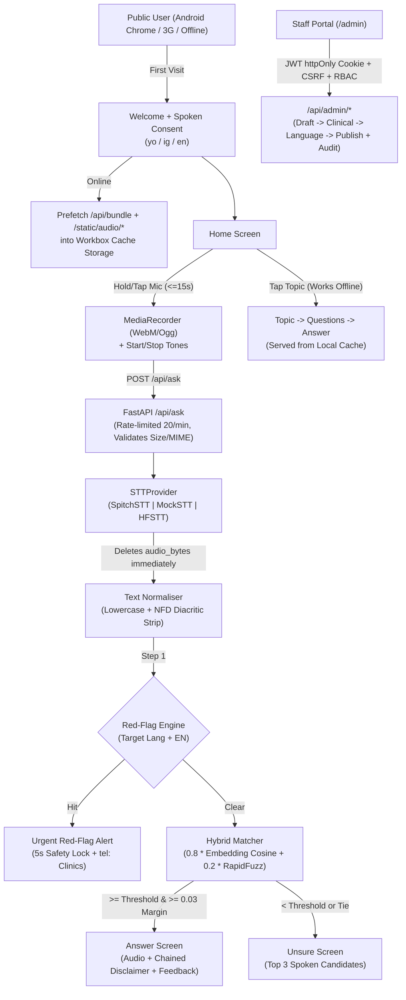

# HealthYarn Architecture (`docs/ARCHITECTURE.md`)

HealthYarn is a voice-first, offline-resilient health information Progressive Web App (PWA) designed for low-end Android devices and intermittent 3G connections.

## Core Architectural Invariants

1. **No Generated Medical Content at Runtime**: No LLM generates, paraphrases, or edits medical answers during a user request. AI is used strictly at runtime for (a) speech-to-text transcription (`STTProvider`) and (b) semantic similarity matching against pre-approved `published` FAQ entries (`FAQMatcher`).
2. **Offline Batch TTS (`YarnGPT`)**: Approved text is converted to `.ogg` (Opus, 24–32 kbps) offline via `backend/scripts/generate_audio.py` or `notebooks/generate_audio_colab.ipynb`.
3. **Red-Flag Safety First**: Every incoming query (voice transcript or typed text) is normalised (lowercase + NFD diacritic-stripped copy) and checked against published `red_flag_rules` in both the target language and English before any matching runs.
4. **Honest Uncertainty**: Below `MATCH_THRESHOLD` or within `0.03` of the runner-up, HealthYarn returns `unsure` with up to 3 candidate questions rather than guessing.
5. **Zero Audio Persistence**: Audio bytes are handled in RAM only, passed to `STTProvider.transcribe()`, and explicitly deleted (`del audio_bytes`). `query_logs` stores zero audio, zero IP addresses, and zero device IDs.

## System Flow Diagram

