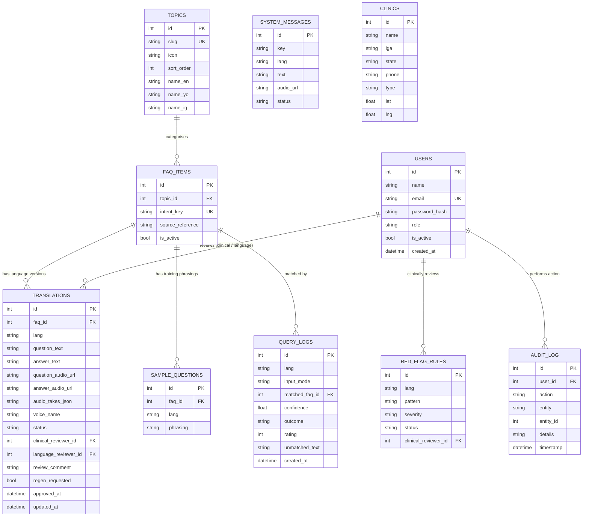

# HealthYarn Database Schema (`docs/DATABASE.md`)

HealthYarn uses **SQLModel** (`SQLAlchemy 2.0`) over **SQLite** for local/contest demos with a direct connection-string migration path to **PostgreSQL** via `DATABASE_URL`.

## Entity-Relationship Diagram

## Content Governance State Machine

`draft` -> `clinical_ok` (by `clinical_reviewer`) -> `language_ok` (by `language_reviewer`, only after clinical approval) -> `published` (by `admin`, blocked if text contains `[PLACEHOLDER – NOT REVIEWED]`). Any edit by `editor` or `admin` resets the translation back to `draft`.
